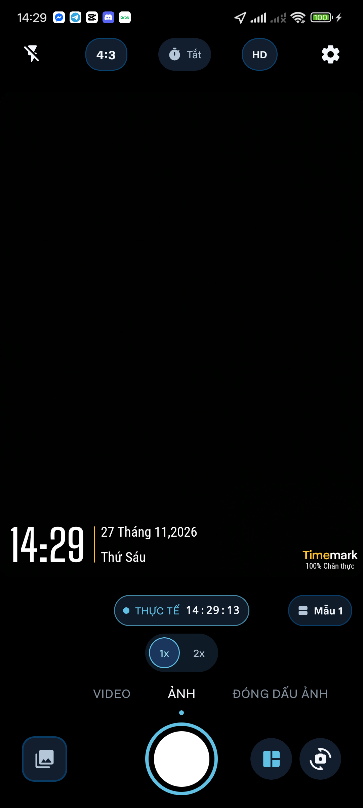
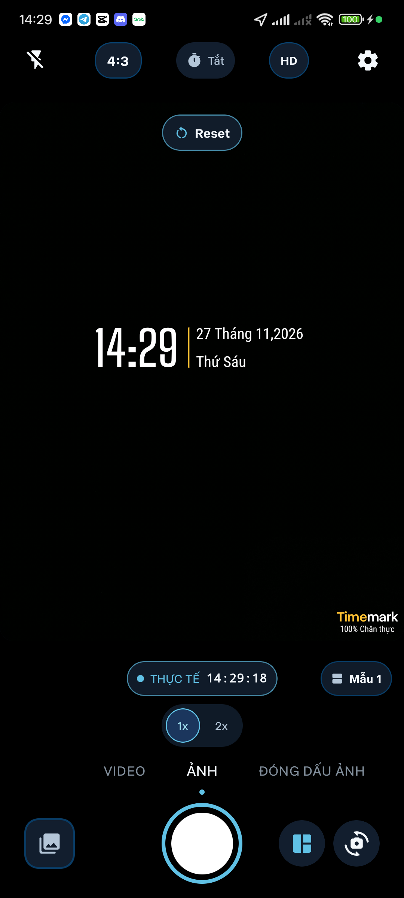
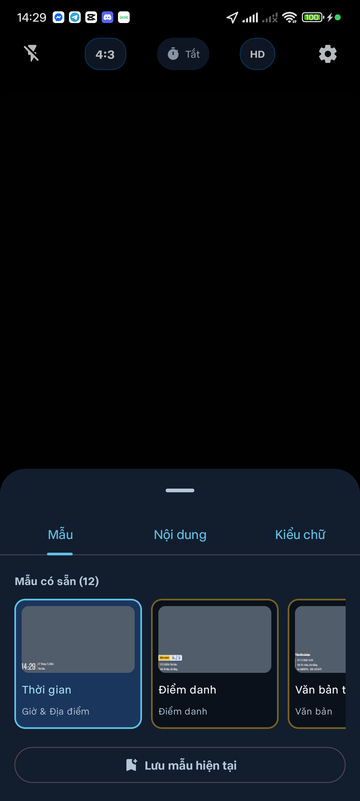
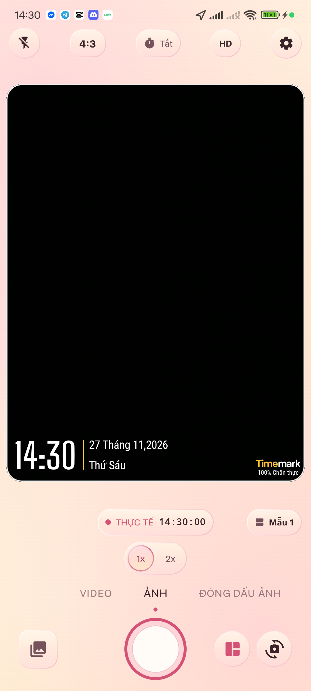

# Time Edit — Open-Source Camera & Custom Timestamp Watermark App

[🇻🇳 Tiếng Việt](README.md) · [🇬🇧 English](README.en.md) · [🇨🇳 简体中文](README.zh-CN.md)

[](#quick-install)
[](LICENSE)
[-3DDC84?style=flat-square)](#build-from-source)
[](#project-architecture)
[](SECURITY.md)

**Time Edit** is a 100% open-source Android camera and timestamp watermark application (`GPL-3.0-or-later`) built for **community freedom and full user control**.

Unlike closed-source timestamp cameras that lock the clock to network time, restrict address/location editing, or paywall layout customization, **Time Edit** lets you **freely configure time, coordinates, addresses, stamp fields, corner badge text, and drag every watermark element anywhere on the frame** — completely free, ad-free, and telemetry-free.

---

## Screenshots

| Dark Mode (Default) | Free Drag & Floating Reset | Watermark Editor | Light Mode (Liquid Glass) |
| :---: | :---: | :---: | :---: |
|  |  |  |  |

---

## Key Features

### 1. Full Time Control & EXIF Synchronization
- **Three Clock Modes**: **Live**, **Fixed** (pick any exact date, hour, minute, second), and **Offset** (± days, hours, minutes relative to live time).
- Writes chosen timestamps and GPS metadata directly into saved PNG EXIF tags (`DateTimeOriginal`, `DateTimeDigitized`, `DateTime`, GPS).
- Always-visible status pill (`• LIVE` / `• CUSTOM`) below the viewfinder for instant verification before shooting.

### 2. CameraX Capture & Real-Time Video Watermarking
- Built with **CameraX** + **Jetpack Compose Viewfinder**: `0.6x / 1x / 2x` lens switching, pinch-to-zoom, tap-to-focus, countdown timer (`Off / 3s / 5s / 10s`), flash control, `4:3` / `16:9` / `1:1` aspect ratios, and a 3×3 rule-of-thirds grid.
- **Selectable PNG Photo Quality (`SD` / `HD` / `FHD`)** backed by streaming PNG file I/O for fast sub-second capture at default HD.
- **Hardware-aware Video Recording (`MP4`)**: real-time Canvas overlay via CameraX `OverlayEffect`, probing `VideoCapabilities.PerformancePoint` on-device to expose only supported presets (`720p 30fps`, `720p 60fps`, `1080p 30fps`, `1080p 60fps`).

### 3. Batch Gallery Photo Stamper
- Stamp single or multiple existing gallery photos with a shared clock config or per-photo timestamps, with optional restoration of each photo's original EXIF capture date.
- Shows a compact orientation-aware `x/n` progress pill with cancellation support.

### 4. Free Dragging for Every Element & 12 Customizable Templates
- **12 built-in templates**: *Time Stamp* (with quick switch between **Layout 1** large digits & **Layout 2** compact bar), *Clock-In*, *Custom Text*, *Completed*, *Engineering Record*, *Work Record*, *Project*, *Service*, *Location Bar*, *Report Sheet*, *Cleaned*, and *Security Patrol*.
- **Move every stamp element freely**: drag the **main watermark block**, **corner brand logo** (keeps the original **Timemark 100% Authentic** badge by default, with options to switch between original variants `Timemark Camera` / `VN` / `EN` / `ZH`, pick a **custom image**, enter **custom text**, resize, or **turn off** completely), and **personal/organization logo** anywhere inside the frame without forced corner snapping.
- **Orientation-aware floating `Reset` button**: appears cleanly along the physical top edge of the frame whenever any element has moved (`0° / 90° / 180° / 270°`), resetting all elements back to defaults in one tap.

### 5. Free Address Resolution, Interactive Map & Telemetry
- Zero paid API keys required: pairs multi-candidate Android `Geocoder` with free **OSM Nominatim (`zoom=18`)** reverse geocoding, plus an interactive **OpenStreetMap** pin picker and proximity-biased search.
- Optional GPS coordinates (3 formats), live hardware compass, altitude, and **Open-Meteo** weather readouts.

### 6. Polished UI & Full Trilingual Support
- **Dark** high-contrast mode and **Light** pastel Liquid Glass theme.
- Complete **Vietnamese**, **English**, and **Simplified Chinese** UI and localized date/weekday formatting.

---

## Quick Install

1. Download `TimeEdit-v1.0.0-release.apk` from **[GitHub Releases](../../releases)**.
2. Verify its **SHA-256** checksum against the attached `SHA256SUMS.txt`.
3. Install on any device running **Android 8.0 (API 26)+** and grant Camera / Location / Microphone permissions as needed.

---

## Build from Source

Requires **JDK 21** and **Android SDK** (`compileSdk 36`, `targetSdk 35`, `minSdk 26`).

```bash
# Run all unit tests and build Debug APK
./gradlew testDebugUnitTest assembleDebug --no-daemon --console=plain

# Build Release APK (with R8 minification & resource shrinking)
./gradlew assembleRelease --no-daemon --console=plain
```

To sign a release build locally, create an ignored `keystore.properties` at the project root (or set `TIMEEDIT_KEYSTORE_PATH`, `TIMEEDIT_KEYSTORE_PASSWORD`, `TIMEEDIT_KEY_ALIAS`, `TIMEEDIT_KEY_PASSWORD`):

```properties
storeFile=/path/to/release.jks
storePassword=...
keyAlias=...
keyPassword=...
```

---

## Project Architecture

```text
app/src/main/kotlin/com/timeedit/camera/
├── core/
│   ├── i18n/         # Trilingual strings (VI, EN, ZH-CN)
│   ├── location/     # Geocoder + OSM Nominatim + compass formatting + Open-Meteo
│   ├── sensors/      # Hysteresis orientation monitor & magnetometer/accelerometer compass
│   ├── storage/      # MediaStore PNG/MP4 output & EXIF metadata sync
│   └── time/         # Live / Fixed / Offset clock engine
├── data/             # Local Jetpack DataStore persistence
├── domain/watermark/ # Watermark models, free positioning, JSON serialization
├── engine/
│   ├── camera/       # CameraX Photo/VideoCapture, hardware capability probing
│   └── renderer/     # Pure Canvas watermark renderer & streaming PNG processor
└── ui/
    ├── camera/       # Camera screen, controls & multi-element free drag overlay
    ├── editor/       # Time dialog, OSM map picker & watermark customizer sheet
    ├── gallery/      # Batch gallery stamper screen
    └── theme/        # Dark & Light Liquid Glass palettes
```

---

## Privacy & Optional Network Services

Time Edit operates locally on-device with no ads, analytics, or proprietary backend. Network requests occur **only when location or weather features are active**:

| Feature | Free Service | Data Sent |
|---|---|---|
| Address lookup / place search | Android `Geocoder` & OSM Nominatim | GPS coordinates or search query |
| Interactive map pin picker | OpenStreetMap Tiles (`osmdroid`) | Visible map tile coordinates |
| Current weather | Open-Meteo API | Rounded GPS coordinates |

---

## Responsible Use

Time Edit is built for personal archiving, flexible layout workflows, field documentation drafts, and privacy-first offline camera usage. Please use it responsibly and comply with applicable verification rules in your organization or jurisdiction.

---

## Contributing & License

- Contributions, translations, and bug reports are welcome — see [CONTRIBUTING.md](CONTRIBUTING.md), [CHANGELOG.md](CHANGELOG.md), and [THIRD_PARTY_NOTICES.md](THIRD_PARTY_NOTICES.md).
- Licensed under the **GNU General Public License v3.0 or later** ([LICENSE](LICENSE)).
