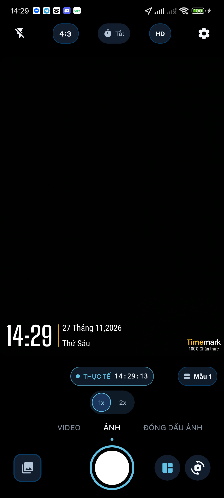
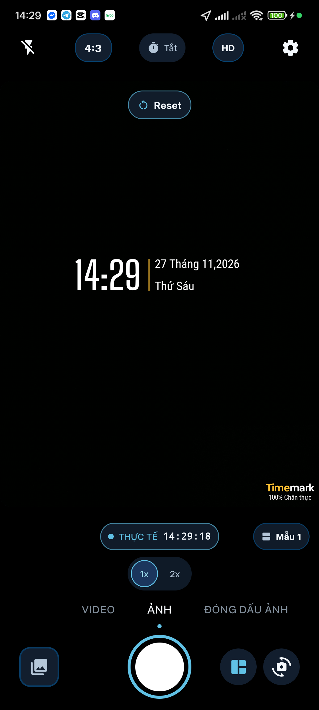
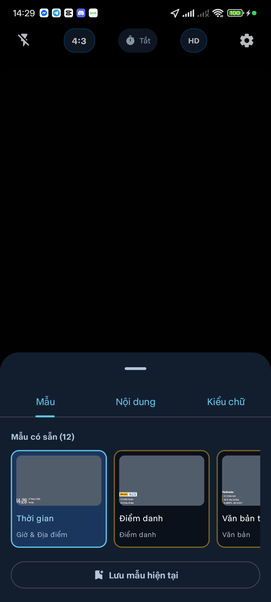
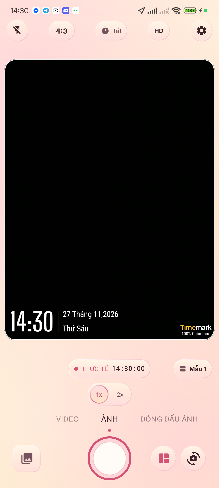

# Time Edit — Camera & Đóng Dấu Thời Gian Tự Do Cho Cộng Đồng

[🇻🇳 Tiếng Việt](README.md) · [🇬🇧 English](README.en.md) · [🇨🇳 简体中文](README.zh-CN.md)

[](#cài-đặt-nhanh)
[](LICENSE)
[-3DDC84?style=flat-square)](#biên-dịch-từ-mã-nguồn)
[](#kiến-trúc-dự-án)
[](SECURITY.md)

**Time Edit** là ứng dụng camera và đóng dấu thời gian, địa điểm mã nguồn mở 100% (`GPL-3.0-or-later`), được xây dựng hướng tới **tính cộng đồng và sự tự do kiểm soát dữ liệu** trên ảnh/video của chính bạn.

Khác với các ứng dụng chụp ảnh đóng dấu đóng nguồn vốn khóa cứng đồng hồ hệ thống, khóa vị trí GPS hoặc chặn chỉnh sửa bố cục khi chưa trả phí, **Time Edit** cho phép người dùng **tự do điều chỉnh thời gian, vị trí, địa chỉ, thông tin chi tiết, chữ nhãn góc phải và kéo thả từng thành phần đóng dấu** — hoàn toàn miễn phí, không quảng cáo và không thu thập dữ liệu.

---

## Ảnh Chụp Thực Tế

| Giao diện Tối (Mặc định) | Kéo thả tự do & Nút Reset | Trình chỉnh sửa mẫu | Giao diện Sáng (Liquid Glass) |
| :---: | :---: | :---: | :---: |
|  |  |  |  |

---

## Tính Năng Nổi Bật

### 1. Tự do quản lý Thời gian & Đồng bộ EXIF
- **3 chế độ đồng hồ**: **Thực tế** (Live), **Giờ cố định** (chọn chính xác ngày/giờ/giây bất kỳ), và **Lệch giờ** (cộng/trừ ngày, giờ, phút theo thời gian thực).
- Tự động ghi và đồng bộ thời gian + tọa độ đã chọn vào thẻ siêu dữ liệu EXIF (`DateTimeOriginal`, `DateTimeDigitized`, `DateTime`, GPS) khi lưu ảnh PNG.
- Hiển thị viên trạng thái `• THỰC TẾ` / `• ĐÃ CHỈNH` ngay dưới khung ngắm để kiểm tra tức thì trước khi bấm chụp.

### 2. Camera & Quay Video Đóng Dấu Trực Tiếp
- Xây dựng trên **CameraX** + **Jetpack Compose Viewfinder**: hỗ trợ chuyển ống kính `0.6x / 1x / 2x`, chụm tay thu phóng, chạm để lấy nét, hẹn giờ (`Tắt / 3s / 5s / 10s`), flash, tỷ lệ khung (`4:3`, `16:9`, `1:1`) và lưới 3×3.
- **Chất lượng ảnh PNG linh hoạt (`SD` / `HD` / `FHD`)**: tối ưu nén PNG trực tiếp ra tệp (`MediaStore`) cho tốc độ lưu nhanh dưới 1 giây ở mức HD mặc định.
- **Quay video MP4 đóng dấu thời gian thực** qua CameraX `OverlayEffect`, tự động kiểm tra năng lực phần cứng của từng máy để hiển thị chính xác các mức được hỗ trợ (`720p 30fps`, `720p 60fps`, `1080p 30fps`, `1080p 60fps`).

### 3. Đóng Dấu Ảnh Hàng Loạt Từ Thư Viện
- Chọn một hoặc nhiều ảnh có sẵn trong thư viện để đóng dấu lại cùng một mốc thời gian hoặc chỉnh thời gian riêng cho từng tấm.
- Tùy chọn dùng nhanh ngày chụp gốc từ EXIF của ảnh khi cần phục hồi hồ sơ hiện trường.
- Tiến trình xuất hàng loạt hiển thị gọn bằng popup `x/n` tự xoay theo hướng cầm điện thoại.

### 4. Kéo Thả Tự Do Mọi Thành Phần & 12 Mẫu Tùy Biến
- **12 mẫu có sẵn** phù hợp nhiều nhu cầu công việc: *Thời gian* (kèm nút đổi nhanh **Mẫu 1** số lớn / **Mẫu 2** thanh ngang), *Điểm danh*, *Văn bản*, *Hoàn thành*, *Hồ sơ kỹ thuật*, *Nhật ký việc*, *Dự án*, *Dịch vụ*, *Tọa độ & La bàn*, *Bảng biểu*, *Đã dọn dẹp*, *Tuần tra*.
- **Kéo thả tự do mọi thành phần** ngay trên khung ngắm và màn hình thư viện: bạn có thể di chuyển riêng lẻ **khối dấu chính**, **logo đóng dấu góc phải** (giữ nguyên mặc định **Timemark 100% Chân thực**, kèm tùy chọn đổi giữa các mẫu logo gốc `Timemark Camera` / `VN` / `EN` / `ZH`, tải **ảnh riêng**, nhập **chữ tùy chỉnh**, chỉnh kích thước hoặc **tắt** hoàn toàn) và **logo doanh nghiệp/tổ chức** tới bất kỳ vị trí nào trên ảnh mà không bị ép dính vào góc.
- **Nút popup `Reset` xoay theo hướng máy**: tự động xuất hiện ở cạnh trên thực tế của khung ảnh (dù cầm dọc hay xoay ngang) khi có thành phần bị dời vị trí, bấm một chạm để đưa mọi thứ về mặc định.

### 5. Địa Chỉ, Bản Đồ Chọn Vị Trí & Thời Tiết Miễn Phí
- Không yêu cầu bất kỳ API key trả phí nào: kết hợp Android `Geocoder` (lọc đa kết quả) với **OSM Nominatim (`zoom=18`)** để lấy tên đường/số nhà đầy đủ, kèm hộp thoại tìm kiếm địa điểm và ghim tọa độ trực tiếp trên bản đồ **OpenStreetMap**.
- Hỗ trợ hiển thị Tọa độ GPS (3 định dạng), La bàn (cảm biến thực tế), Độ cao và Thời tiết (**Open-Meteo**).

### 6. Giao Diện Tinh Gọn & Đa Ngôn Ngữ
- **2 chế độ giao diện**: **Tối** tương phản cao dịu mắt khi chụp thiếu sáng và **Sáng** phong cách Liquid Glass pastel.
- **3 ngôn ngữ đầy đủ**: **Tiếng Việt**, **English**, **简体中文** — định dạng ngày tháng và tiêu đề mẫu tự động đồng bộ theo ngôn ngữ đã chọn.

---

## Cài Đặt Nhanh

1. Tải tệp `TimeEdit-v1.0.0-release.apk` từ trang **[GitHub Releases](../../releases)**.
2. (Khuyến nghị) Kiểm tra mã băm **SHA-256** khớp với tệp `SHA256SUMS.txt` đi kèm bản phát hành.
3. Cài đặt APK trên thiết bị chạy **Android 8.0 (API 26)** trở lên và cấp quyền Camera / Vị trí / Ghi âm khi sử dụng.

---

## Biên Dịch Từ Mã Nguồn

Yêu cầu môi trường: **JDK 21** và **Android SDK** (`compileSdk 36`, `targetSdk 35`, `minSdk 26`).

```bash
# Chạy toàn bộ unit test và biên dịch bản Debug APK
./gradlew testDebugUnitTest assembleDebug --no-daemon --console=plain

# Biên dịch bản Release (bật R8 thu gọn & tối ưu tài nguyên)
./gradlew assembleRelease --no-daemon --console=plain
```

Để ký bản Release APK với khóa của riêng bạn, tạo tệp `keystore.properties` (đã được `.gitignore` loại trừ) ở thư mục gốc dự án hoặc truyền biến môi trường `TIMEEDIT_KEYSTORE_PATH`, `TIMEEDIT_KEYSTORE_PASSWORD`, `TIMEEDIT_KEY_ALIAS`, `TIMEEDIT_KEY_PASSWORD`:

```properties
storeFile=/duong/dan/toi/release.jks
storePassword=...
keyAlias=...
keyPassword=...
```

---

## Kiến Trúc Dự Án

```text
app/src/main/kotlin/com/timeedit/camera/
├── core/
│   ├── i18n/         # Bộ chuỗi đa ngôn ngữ (Tiếng Việt, English, 简体中文)
│   ├── location/     # Geocoder + OSM Nominatim + định dạng địa chỉ/la bàn + Open-Meteo
│   ├── sensors/      # Giám sát xoay thiết bị (hysteresis) & cảm biến la bàn
│   ├── storage/      # Lưu ảnh PNG & video MP4 qua MediaStore kèm EXIF
│   └── time/         # Engine thời gian Live / Cố định / Lệch giờ
├── data/             # Lưu cấu hình cục bộ bằng Jetpack DataStore
├── domain/watermark/ # Mô hình mẫu dấu, tọa độ tự do, serialize JSON
├── engine/
│   ├── camera/       # CameraX Capture/VideoCapture, phát hiện phần cứng & cấu hình chất lượng
│   └── renderer/     # Bộ vẽ dấu Canvas thuần & xuất ảnh PNG/EXIF tối ưu tốc độ
└── ui/
    ├── camera/       # Màn hình camera chính, thanh điều khiển & overlay kéo thả đa thành phần
    ├── editor/       # Hộp thoại chỉnh giờ, chọn vị trí bản đồ OSM & bảng tùy biến dấu
    ├── gallery/      # Màn hình đóng dấu ảnh hàng loạt từ thư viện
    └── theme/        # Bảng màu Tối & Sáng Liquid Glass
```

---

## Quyền Riêng Tư & Dịch Vụ Mạng

Time Edit hoạt động độc lập trên thiết bị, không chứa quảng cáo và không gửi dữ liệu người dùng về máy chủ riêng. Các kết nối mạng sau **chỉ chạy khi bạn bật tính năng tương ứng**:

| Tính năng | Dịch vụ miễn phí sử dụng | Dữ liệu gửi đi |
|---|---|---|
| Phân giải / tìm kiếm địa chỉ | Android `Geocoder` & OSM Nominatim | Tọa độ GPS hoặc từ khóa tìm kiếm |
| Bản đồ chọn vị trí thủ công | OpenStreetMap Tile (`osmdroid`) | Tọa độ vùng bản đồ đang xem |
| Thời tiết hiện tại | Open-Meteo API | Tọa độ GPS đã làm tròn |

---

## Lưu Ý Sử Dụng Có Trách Nhiệm

Time Edit được xây dựng cho mục đích ghi nhận hiện trường, sắp xếp lưu trữ cá nhân, thiết kế bố cục ảnh/video và bảo vệ quyền kiểm soát dữ liệu ngoại tuyến. Vui lòng sử dụng có trách nhiệm và tuân thủ quy định pháp luật cũng như quy chế xác thực tại nơi bạn làm việc.

---

## Đóng Góp & Giấy Phép

- Mọi đóng góp mã nguồn, dịch thuật và báo lỗi đều được hoan nghênh — xem thêm tại [CONTRIBUTING.md](CONTRIBUTING.md), [CHANGELOG.md](CHANGELOG.md), [THIRD_PARTY_NOTICES.md](THIRD_PARTY_NOTICES.md).
- Dự án được phát hành theo giấy phép **GNU General Public License v3.0 or later** — xem chi tiết trong [LICENSE](LICENSE).
