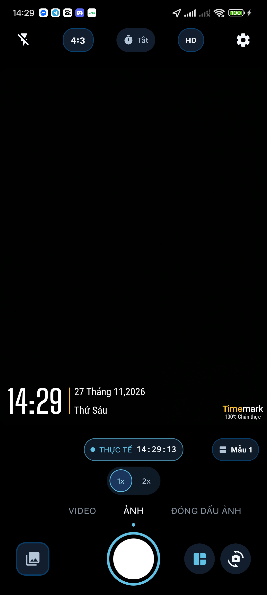
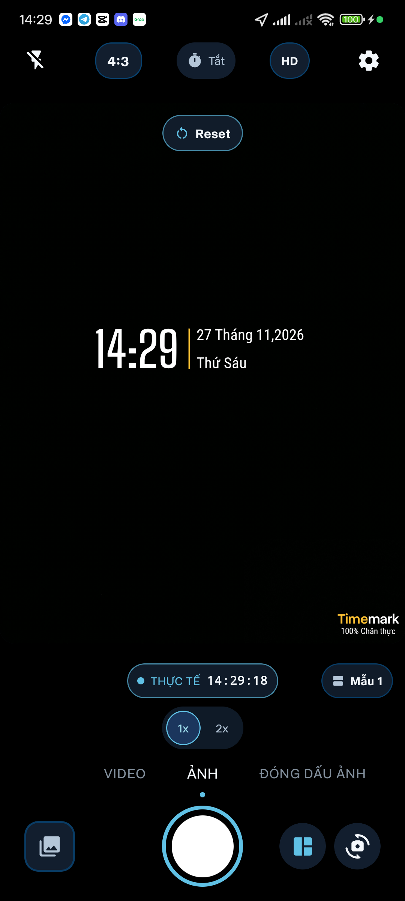
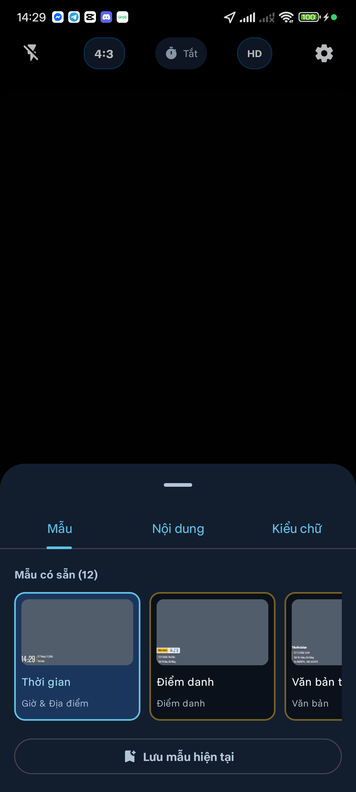
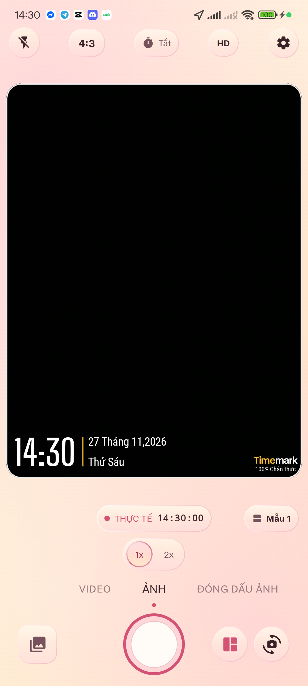

# Time Edit — 开源自由时间与地点水印相机

[🇻🇳 Tiếng Việt](README.md) · [🇬🇧 English](README.en.md) · [🇨🇳 简体中文](README.zh-CN.md)

[](#快速安装)
[](LICENSE)
[-3DDC84?style=flat-square)](#从源码构建)
[](#项目架构)
[](SECURITY.md)

**Time Edit** 是一款 100% 开源的 Android 时间与位置水印相机应用（`GPL-3.0-or-later`），致力于为用户提供**自由、透明且完全可控**的拍摄与照片时间戳工具。

不同于锁定系统时间、限制地址编辑或将排版定制设为付费功能的闭源水印相机，**Time Edit** 允许你**自由调整时间、坐标位置、详细地址、自定义字段、角落品牌文字，并在画面内任意拖拽各个水印元素** — 完全免费、无广告、无数据收集。

---

## 应用截图

| 深色模式（默认） | 自由拖拽与悬浮 Reset | 水印模板编辑器 | 浅色模式（Liquid Glass） |
| :---: | :---: | :---: | :---: |
|  |  |  |  |

---

## 核心功能

### 1. 自由时间控制与 EXIF 元数据同步
- **3 种时钟模式**：**实时时间**、**固定时间**（任意指定年月日时分秒）以及 **时间偏移**（相对当前时间增减天/时/分）。
- 保存 PNG 照片时同步将所选时间与 GPS 坐标写入 EXIF 标签（`DateTimeOriginal`、`DateTimeDigitized`、`DateTime`、GPS）。
- 取景框下方常驻状态胶囊（`• 实时` / `• 自定义`），拍摄前一目了然。

### 2. CameraX 拍照与实时水印录像
- 基于 **CameraX** + **Jetpack Compose Viewfinder**：支持 `0.6x / 1x / 2x` 焦段切换、双指缩放、点击对焦、倒计时（`关闭 / 3秒 / 5秒 / 10秒`）、闪光灯、`4:3` / `16:9` / `1:1` 画幅比例与九宫格辅助线。
- **可选 PNG 照片画质（`SD` / `HD` / `FHD`）**：采用流式 PNG 文件写入，默认 HD 画质下不到 1 秒即可完成保存。
- **硬件自适应水印录像（`MP4`）**：通过 CameraX `OverlayEffect` 实时绘制 Canvas 水印，并自动检测本机编解码器能力，仅显示硬件真实支持的分辨率与帧率（`720p 30fps`、`720p 60fps`、`1080p 30fps`、`1080p 60fps`）。

### 3. 相册批量补打水印
- 支持选择单张或多张相册图片，批量使用同一时间配置或逐张独立设置，并支持一键读取照片原始 EXIF 拍摄时间。
- 导出过程中在画幅顶部显示随握持方向旋转的 `x/n` 进度胶囊并支持随时取消。

### 4. 全元素自由拖拽与 12 套专业模板
- **内置 12 套模板**：*经典时间*（支持 **样式 1** 大数字与 **样式 2** 紧凑横栏一键切换）、*考勤打卡*、*自定义文本*、*任务完成*、*工程记录*、*工作记录*、*项目管理*、*售后服务*、*经纬方位*、*表格清单*、*保洁完成*、*安全巡逻*。
- **所有水印元素自由移动**：支持分别拖动 **主水印框**、**右下角品牌标识**（默认保留原版 **Timemark 100% 真实** 徽章，同时支持切换 `Timemark Camera` / `VN` / `EN` / `ZH` 原版样式、上传 **自定义图片**、输入 **自定义文字**、缩放大小或完全 **关闭**）以及 **机构/个人 Logo** 至画面任意位置，不再强制吸附角落。
- **随方向旋转的悬浮 `Reset` 按钮**：只要有任意元素偏离默认位置，按钮会自动出现在手机物理方向对应的画幅顶部边缘（`0° / 90° / 180° / 270°`），一键恢复默认位置。

### 5. 免费地址解析、地图选点与气象信息
- 无需任何付费 API Key：结合 Android 系统 `Geocoder` 多候选筛选与 **OSM Nominatim（`zoom=18`）** 解析街道/门牌号，并提供 **OpenStreetMap** 交互式地图选点与就近搜索。
- 可选展示 GPS 经纬度（3 种格式）、实测指南针方位、海拔高度与 **Open-Meteo** 实时天气。

### 6. 精致界面与完整三语支持
- 提供高对比 **深色模式** 与温润细腻的 **浅色模式（Liquid Glass）**。
- 原生支持 **简体中文**、**Tiếng Việt**、**English**，日期与模板标题随语言自动切换。

---

## 快速安装

1. 前往 **[GitHub Releases](../../releases)** 下载 `TimeEdit-v1.0.0-release.apk`。
2. 建议核对发行说明中附带的 `SHA256SUMS.txt` 校验和。
3. 在 **Android 8.0（API 26）** 及以上设备安装并按需授予相机 / 定位 / 麦克风权限。

---

## 从源码构建

环境要求：**JDK 21** 与 **Android SDK**（`compileSdk 36`、`targetSdk 35`、`minSdk 26`）。

```bash
# 运行全部单元测试并构建 Debug APK
./gradlew testDebugUnitTest assembleDebug --no-daemon --console=plain

# 构建开启 R8 代码压缩与资源精简的 Release APK
./gradlew assembleRelease --no-daemon --console=plain
```

如需本地签名 Release APK，可在项目根目录创建被 `.gitignore` 忽略的 `keystore.properties`（或配置环境变量 `TIMEEDIT_KEYSTORE_PATH`、`TIMEEDIT_KEYSTORE_PASSWORD`、`TIMEEDIT_KEY_ALIAS`、`TIMEEDIT_KEY_PASSWORD`）：

```properties
storeFile=/path/to/release.jks
storePassword=...
keyAlias=...
keyPassword=...
```

---

## 项目架构

```text
app/src/main/kotlin/com/timeedit/camera/
├── core/
│   ├── i18n/         # 三语本地化资源（简体中文 / Tiếng Việt / English）
│   ├── location/     # Geocoder + OSM Nominatim + 方位格式化 + Open-Meteo 天气
│   ├── sensors/      # 带滞回防抖的方向监听与电子罗盘传感器
│   ├── storage/      # MediaStore PNG/MP4 输出与 EXIF 元数据写入
│   └── time/         # 实时 / 固定 / 偏移时间引擎
├── data/             # Jetpack DataStore 本地持久化
├── domain/watermark/ # 水印数据模型、自由坐标计算与 JSON 编解码
├── engine/
│   ├── camera/       # CameraX 拍照/录像管线与硬件能力检测
│   └── renderer/     # 纯 Canvas 矢量与文字水印渲染器及高速 PNG 流式处理器
└── ui/
    ├── camera/       # 主相机界面、控制栏与多元素自由拖拽覆盖层
    ├── editor/       # 时间编辑弹窗、OSM 地图选点及水印样式面板
    ├── gallery/      # 相册批量水印界面
    └── theme/        # 深色与浅色 Liquid Glass 主题配色
```

---

## 隐私与网络使用说明

Time Edit 纯本地运行，不含广告与任何第三方统计 SDK。仅在启用定位或天气功能时访问以下公开免费服务：

| 功能 | 免费服务 | 发送内容 |
|---|---|---|
| 逆地理编码 / 地点搜索 | Android `Geocoder` 与 OSM Nominatim | GPS 坐标或搜索关键词 |
| 地图选点瓦片 | OpenStreetMap Tiles（`osmdroid`） | 当前可视区域瓦片坐标 |
| 实时天气信息 | Open-Meteo API | 粗略 GPS 坐标 |

---

## 负责任使用提示

Time Edit 旨在满足个人摄影归档、离线现场记录草稿与灵活排版创作需求。请合理合规使用本软件，并遵守所在机构或地区的图像真实性规范。

---

## 参与贡献与开源协议

- 欢迎提交 Issue、多语言改进或 Pull Request，请参阅 [CONTRIBUTING.md](CONTRIBUTING.md)、[CHANGELOG.md](CHANGELOG.md) 与 [THIRD_PARTY_NOTICES.md](THIRD_PARTY_NOTICES.md)。
- 本项目基于 **GNU General Public License v3.0 or later** 开源发布，详情见 [LICENSE](LICENSE)。
